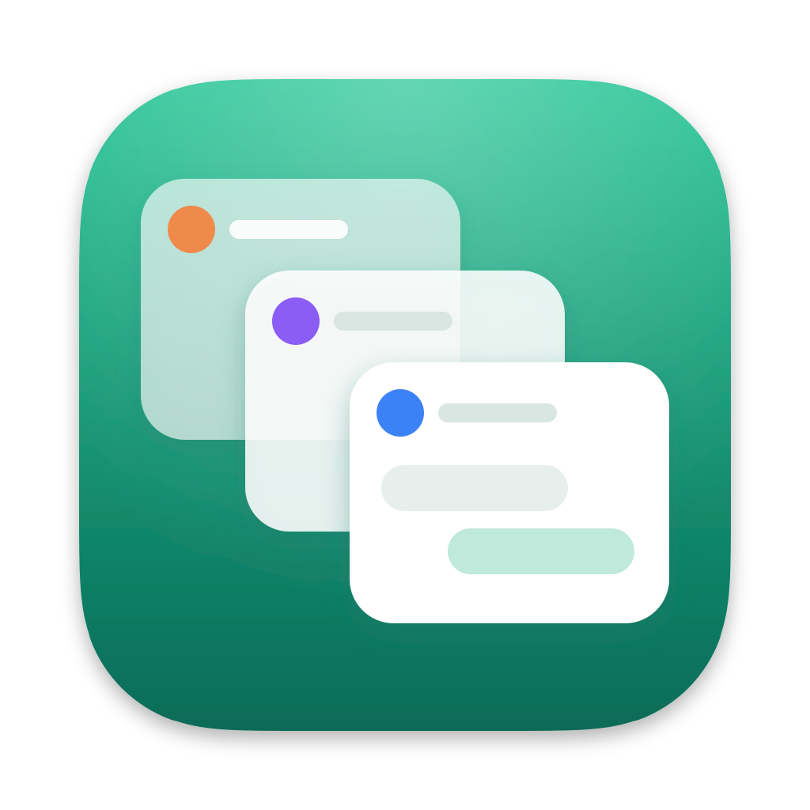
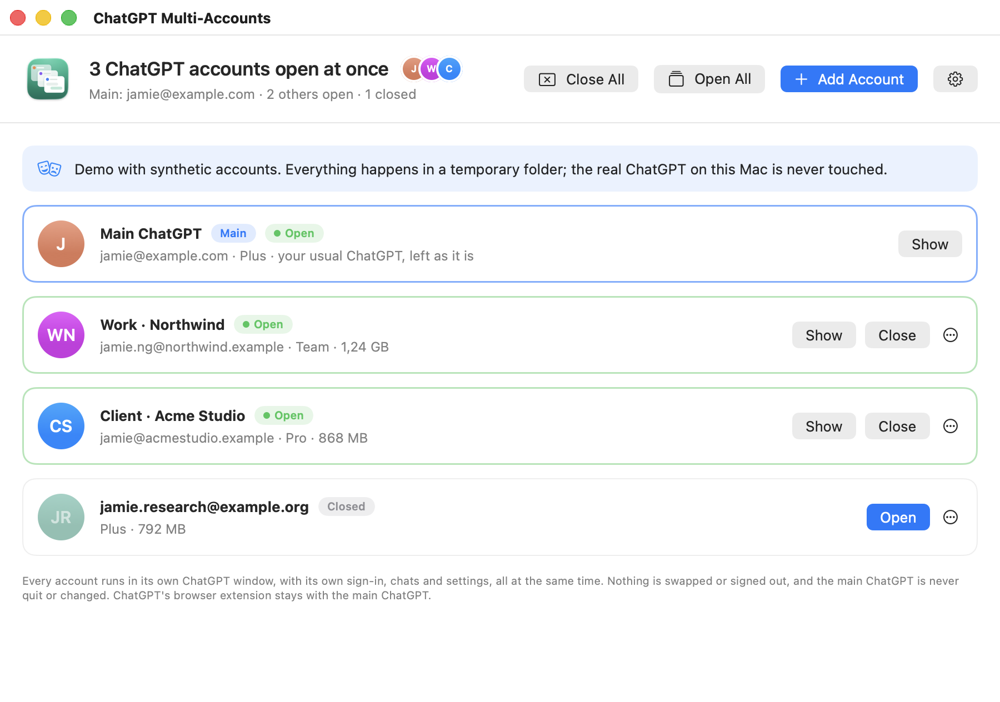
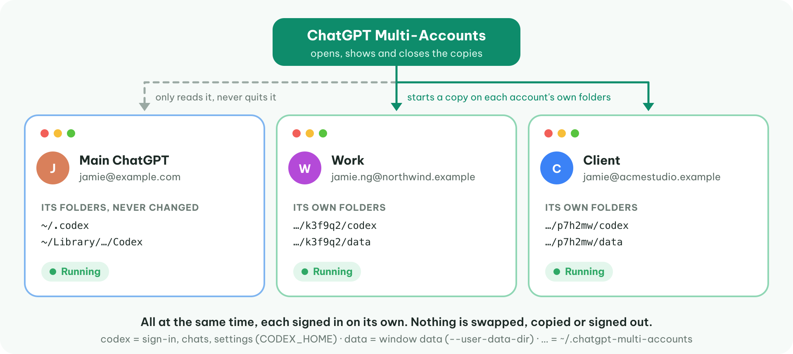
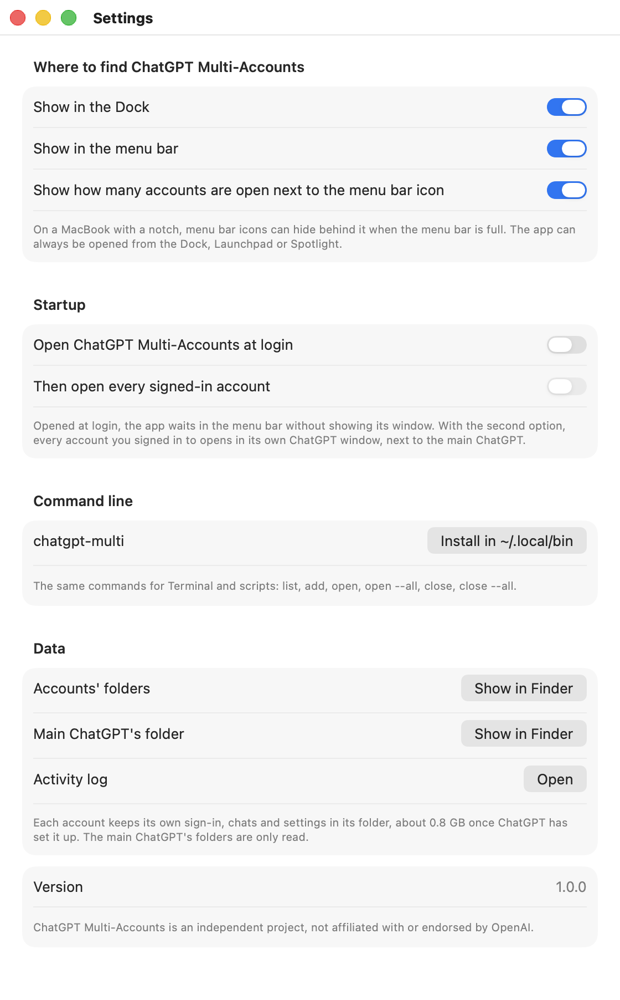
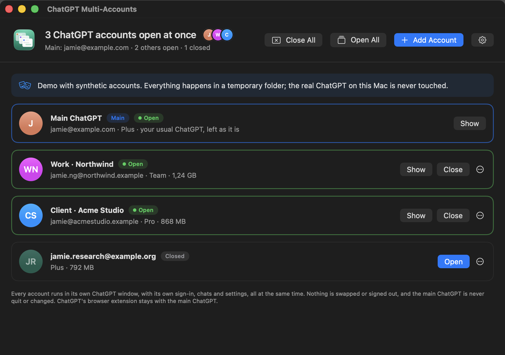

<p align="center"></p>

# ChatGPT Multi-Accounts

**Use several ChatGPT accounts at the same time** in the **ChatGPT desktop app** on one Mac.

Each account gets its own ChatGPT window, signed in on its own, running right next to your main ChatGPT. Chat with your work account in one window while a task runs on your personal account in another, and keep a client's account open in a third. There is no switching back and forth: nothing is swapped, signed out or restarted, and every account stays signed in for as long as you like.

<p align="center"></p>
<p align="center"><sub>Synthetic accounts from the app's demo.</sub></p>

**macOS only** (macOS 13 or later, Apple silicon and Intel), for the ChatGPT desktop app that includes Codex (version 26.1013 or later, `com.openai.codex`). It comes two ways, built from the same code:

- **ChatGPT Multi-Accounts.app**: a window, a Dock icon and a menu bar item.
- **`chatgpt-multi`**: the same thing on the command line.

> [!IMPORTANT]
> **Not affiliated with OpenAI.** ChatGPT Multi-Accounts is an independent, unofficial project. It is not made, endorsed or supported by OpenAI. “ChatGPT” is OpenAI's trademark and is named here only to say which app this tool works with. Use each of your accounts in line with OpenAI's terms. For help with ChatGPT itself, contact OpenAI, not this project.

> [!WARNING]
> **Use at your own risk.** The app starts extra copies of the ChatGPT app on folders of their own. It is careful (it never quits or changes your main ChatGPT, never copies a sign-in and never force-quits anything), but it comes with no warranty. See [LICENSE](LICENSE).

## Contents

- [At the same time, not one after another](#at-the-same-time-not-one-after-another)
- [How it works](#how-it-works)
- [What to expect](#what-to-expect)
- [Install](#install)
- [Use](#use)
- [Demo](#demo)
- [Command line](#command-line)
- [Files and uninstalling](#files-and-uninstalling)
- [Good to know](#good-to-know)
- [Project layout and tests](#project-layout-and-tests)

## At the same time, not one after another

Account switchers sign one account out so another can sign in, then do it again in reverse. This app never does that. Every account you add keeps its own sign-in in its own folder and runs in its own copy of ChatGPT, so:

| | Swapping accounts | ChatGPT Multi-Accounts |
|---|---|---|
| Accounts in use at once | one | all of them: the main ChatGPT plus every account you open |
| Changing account | quit ChatGPT, swap the sign-in, reopen | click the other account's window |
| Running chats and tasks | stop when ChatGPT quits | keep running in every window |
| Your main ChatGPT | restarted on every switch | never quit or changed |
| Sign-ins | copied back and forth | each signed in once, in its own window; never copied |

**Open All** starts every signed-in account, and the main ChatGPT, with one click; the header tells you how many accounts are open at once. **Close All** quits every account's window and leaves the main ChatGPT running.

## How it works

<p align="center"></p>

The ChatGPT desktop app is built on OpenAI's own Chromium-based runtime and can run on folders other than its usual ones. It keeps everything in two places:

| What | Main ChatGPT | An account's copy |
|------|--------------|-------------------|
| Sign-in (`auth.json`), chats, settings | `~/.codex` | `~/.chatgpt-multi-accounts/<id>/codex` (its `CODEX_HOME`) |
| Window data: cookies, caches | `~/Library/Application Support/Codex` | `~/.chatgpt-multi-accounts/<id>/data` (its `--user-data-dir`) |

To open an account, the app starts another copy of the same `ChatGPT.app` with ChatGPT's own settings for this: `CODEX_HOME` and `CODEX_ELECTRON_USER_DATA_PATH` point at the account's folders, and Chromium's `--user-data-dir` does too (without it, a second copy hands itself over to the one already running and exits). ChatGPT keeps its single-instance lock inside that folder, so copies on different folders run side by side.

Each copy signs in on its own, through ChatGPT's normal sign-in. Sign-ins are never copied between folders, so no two copies share one set of tokens, and nothing is sent anywhere by this app. It reads only the public part of each sign-in's ID token (email, name, plan) to label the list.

The full details, including the two app-wide ChatGPT settings the app looks after, are in [docs/how-it-works.md](docs/how-it-works.md).

## What to expect

**Each window is a full ChatGPT of its own.** An account's window has its own settings, connectors, plugins and local Codex projects and history, separate from the main ChatGPT's. Your conversations live in your ChatGPT account, so they show in every window signed in to that account.

**It takes disk space.** On first start, ChatGPT sets up its plugins and tools in the account's folder: about 0.8 GB per account. The app shows each account's size.

**ChatGPT's browser extension stays with the main ChatGPT.** Every copy of ChatGPT that starts tries to register itself with the extension (ChatGPT for Chrome, Edge, Brave and others), and the last one would win. The app puts the main ChatGPT back each time, within seconds; see [how it works](docs/how-it-works.md#the-browser-extension). Use the extension with the main ChatGPT.

**The Dock shows one ChatGPT icon per copy, all alike.** Tell windows apart by the account in each one, or bring one forward from this app or its menu bar menu. Clicking ChatGPT's own Dock icon, or opening ChatGPT from Spotlight, brings forward whichever copy macOS picks: to start the main ChatGPT while accounts are open, use **Open** on its row.

**Only the main ChatGPT checks for updates.** The copies run the same `ChatGPT.app`. When ChatGPT updates itself, close the accounts' windows (**Close All**) and open them again afterwards (**Open All**).

**Sign in to one new account at a time.** ChatGPT's sign-in waits for the browser on a local port that every copy uses, so finish one window's sign-in before starting the next.

**Logging out in an account's window signs out that window only.** The main ChatGPT and the other accounts stay signed in. Log out there when you want that window to use another account.

**It depends on how ChatGPT works today.** OpenAI built the settings this app uses into ChatGPT, but doesn't document them for this purpose. Run `chatgpt-multi doctor` after a ChatGPT update: every line should say `ok`.

**The download isn't notarized by Apple**, so macOS shows a security warning the first time it opens. [First open](#first-open) explains why and how to open it.

## Install

You need macOS 13 or later and the [ChatGPT desktop app](https://chatgpt.com/download), opened once.

### Build it yourself

You need Apple's developer tools for `swift`: Xcode, or the Command Line Tools (`xcode-select --install`). In this folder:

```bash
macos/scripts/install.sh
```

It builds the app and the command, installs `~/Applications/ChatGPT Multi-Accounts.app`, links `~/.local/bin/chatgpt-multi` to the command inside it, and opens the app. A copy you build on your own Mac opens without the security warning. To build without installing, run `macos/scripts/build.sh` (the result is in `macos/build/`).

### From a release

When a release is published (`macos/scripts/release.sh` packs one):

1. Download **ChatGPT-Multi-Accounts-…-macOS.zip** from the release.
2. Open the zip and drag **ChatGPT Multi-Accounts.app** into **Applications**.
3. Open it. The first time, macOS shows a security warning: see [First open](#first-open).

To check a download, run `shasum -a 256 -c SHA256SUMS.txt` in the folder with the release's zip files and `SHA256SUMS.txt`.

### First open

macOS warns about every app Apple hasn't checked (notarized). Notarizing needs a paid Apple Developer account, so you see the warning once. It doesn't mean macOS found a problem with the app. All the source is in this repository; if you'd rather not trust the download, [build it yourself](#build-it-yourself).

**macOS 15 Sequoia and later, including macOS 26 Tahoe:** open the app and click **Done** (not Move to Trash). In **System Settings → Privacy & Security**, scroll to **Security** and click **Open Anyway** next to “ChatGPT Multi-Accounts”, then **Open Anyway** again, and confirm with your password or Touch ID.

**macOS 13 Ventura and 14 Sonoma:** in Finder, Control-click (or right-click) the app, choose **Open**, then click **Open**.

**Any version, in Terminal:**

```bash
xattr -dr com.apple.quarantine "/Applications/ChatGPT Multi-Accounts.app"
```

## Use

### Add your first account

1. Open ChatGPT Multi-Accounts. The window shows your **Main ChatGPT**: the account it is signed in to, and whether it is open. The app only reads it.
2. Click **Add Account**. Give it a name if you like (it is named after its email otherwise) and click **Open Sign-In Window**.
3. A new ChatGPT window opens at its sign-in screen, next to your main ChatGPT, which keeps running. Sign in there with the other account. The list shows the account as soon as it has signed in.

Repeat for as many accounts as you like. If ChatGPT finishes its sign-in in your web browser and the browser goes straight to an account you already use here, sign out on that page (or use another browser profile) and sign in with the other account. The app marks an account that signed in to the same account as the main ChatGPT or another one, so a mix-up is easy to spot.

### Every day

- **Open All** opens every signed-in account, each in its own window, plus the main ChatGPT if it isn't open. The header shows how many ChatGPT accounts are open at once.
- **Show** brings an account's window forward; **Close** quits it, like ⌘Q in that window. It stays signed in, ready to open again.
- **Open** on a closed account starts its window again, still signed in.
- **Close All** quits every account's window. The main ChatGPT keeps running.
- The **⋯** button has **Rename…**, **Show Folder in Finder** and **Remove…** (which moves the account's folder to the Trash; close its window first).

Closing this app's window doesn't quit it; it keeps the menu bar item and the browser extension guard going. Quit it with ⌘Q. The accounts' ChatGPT windows keep running either way.

### The menu bar and the Dock

The menu bar item shows how many ChatGPT accounts are open. Its menu lists the main ChatGPT and every account (a check mark means open): click one to bring it forward, or to open it if it is closed. Hold ⌥ to close an open account instead. **Open All Accounts**, **Close All Accounts** and **Add Account…** are there too, and in the Dock icon's menu (Control-click).

### Settings

<p align="center"></p>

Click the gear (or ⌘,) to show or hide the Dock icon, the menu bar item and the count next to it; open the app at login, and then open every signed-in account too; install the `chatgpt-multi` command; and show the accounts' folders, the main ChatGPT's folder or the activity log.

The app follows your Mac's light or dark appearance:

<p align="center"></p>

## Demo

To try the app, or show it, without your own accounts:

```bash
open -n "$HOME/Applications/ChatGPT Multi-Accounts.app" --args --demo
```

The demo uses synthetic accounts in a temporary folder. Every button works on that data, including Open All, Close All and adding accounts (a pretend sign-in arrives two seconds after a window "opens"). The demo never starts ChatGPT or touches its data, and keeps its settings separately. The screenshots in this README come from the demo; `docs/screenshots/make-screenshots.sh` draws them again.

## Command line

In **Settings → Command line**, click **Install in ~/.local/bin** (or run `macos/scripts/install.sh`). Then:

```bash
chatgpt-multi list                    # the main ChatGPT and every account, and which are open
chatgpt-multi add --name Work         # add an account: a new ChatGPT window opens at its sign-in screen
chatgpt-multi open --all              # open every signed-in account, and the main ChatGPT, at once
chatgpt-multi open Work client@x.com  # open accounts by name, email or list number
chatgpt-multi show 2                  # bring an open account's window forward (`main` for the main one)
chatgpt-multi close --all             # quit every account's window; the main ChatGPT keeps running
chatgpt-multi rename 2 "Client"
chatgpt-multi remove 3                # its folders go to the Trash
chatgpt-multi doctor                  # check this Mac's ChatGPT looks as expected
chatgpt-multi paths                   # where everything is kept
```

`list --json` prints the same as JSON, for scripts. After `add` or `open`, the command leaves a small process behind for two minutes to keep the browser extension with the main ChatGPT, then it exits.

## Files and uninstalling

Everything the app keeps is private to your user:

```
~/.chatgpt-multi-accounts/
  accounts.json        names and order of your accounts
  <id>/codex/          an account's sign-in, chats and settings (its CODEX_HOME)
  <id>/data/           an account's window data (its --user-data-dir)
  activity.log         what was added, opened, closed and fixed
```

The main ChatGPT's `~/.codex` and `~/Library/Application Support/Codex` are only read. **Remove…** moves an account's folder to the Trash, where you can still get it back.

To uninstall: **Close All**, quit ChatGPT Multi-Accounts and delete it, then:

```bash
rm -rf ~/.local/bin/chatgpt-multi ~/.chatgpt-multi-accounts
```

That forgets the accounts' sign-ins on this Mac (the accounts themselves are untouched). The main ChatGPT stays as it was.

## Good to know

- **Your main ChatGPT is never quit.** Close and Close All only ever quit an account's own copy, found by its folder; it is asked to quit like ⌘Q in its window and is never force-quit. If ChatGPT asks to confirm quitting (a task still running), confirm in that window.
- **A copy that won't start**: run `chatgpt-multi doctor`, and see ChatGPT's own log in `~/Library/Logs/com.openai.codex`.
- **Folder paths must stay short.** ChatGPT puts sockets inside each account's folders and macOS limits a socket path to 103 bytes, so the accounts live in `~/.chatgpt-multi-accounts` under six-letter folder names. With a very long user name, set `CMA_HOME` to a shorter folder for the command.
- **Activity log:** `~/.chatgpt-multi-accounts/activity.log`, or **Settings → Activity log**.

## Project layout and tests

```
macos/              the app and the command (a Swift package), its build scripts and tests
docs/               how it works, the diagram and the README screenshots
assets/icon/        the app icon: the SVG master and the script that exports it
```

Building and testing are described in [macos/README.md](macos/README.md):

```bash
cd macos
swift test                                                              # the account logic, with a pretend ChatGPT
swift build && /usr/bin/python3 -m unittest discover -s Tests/cli -v   # the command, end to end
```

## License

[MIT](LICENSE). The software is provided “as is”, without warranty of any kind.
